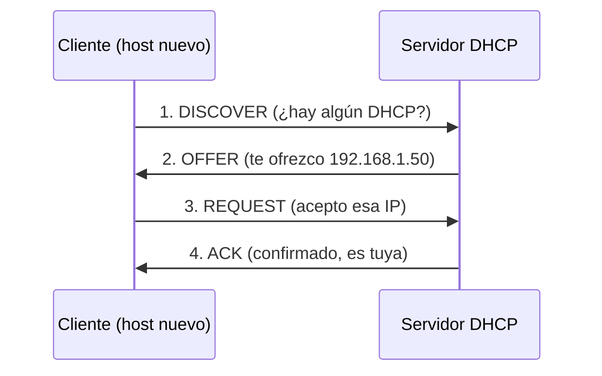

 
# 🌐 Fundamentos de Redes: IP, Hosts y DHCP
 
> [!abstract] Resumen
> Tres piezas básicas de cualquier red:
> - **Host** → cualquier dispositivo conectado a la red.
> - **IP** → la "dirección" que identifica a cada host.
> - **DHCP** → el servicio que reparte esas direcciones de forma automática.
 
---
 
## 🖥️ ¿Qué es un Host?
 
Un **host** es cualquier dispositivo conectado a una red que puede **enviar o recibir** datos. Si tiene una dirección IP y participa en la comunicación, es un host.
 
Ejemplos:
- Tu portátil, móvil o PC.
- Un servidor web.
- Una impresora de red.
- Una Raspberry Pi.
- Routers y switches gestionables (estos además *encaminan* tráfico).
> [!info] Host vs. nodo
> Todo host es un nodo, pero no todo nodo es un host. Un **nodo** es cualquier punto de la red (incluye dispositivos que solo reenvían tráfico sin ser el origen/destino final). El **host** es el extremo que produce o consume los datos.
 
Cada host se identifica de dos formas principales:
 
| Identificador | Capa | Ejemplo | Característica |
|---|---|---|---|
| Dirección **MAC** | Enlace (L2) | `A4:83:E7:1B:2C:9D` | Física, "única" por tarjeta de red |
| Dirección **IP** | Red (L3) | `192.168.1.50` | Lógica, puede cambiar |
 
---
 
## 📍 ¿Qué es una IP?
 
Una **dirección IP** (*Internet Protocol*) es el identificador lógico que permite que un host sea localizable dentro de una red y que los paquetes lleguen a su destino. Es el equivalente a la dirección postal de una casa.
 
### IPv4
 
El formato más común. Son **32 bits** divididos en 4 octetos (0–255):
 
```
192.168.1.50
└─┬─┘ └┬┘ └┬┘
 red    host
```
 
La división entre "parte de red" y "parte de host" la marca la **máscara de subred**:
 
```
IP:       192.168.1.50
Máscara:  255.255.255.0   →  /24
Red:      192.168.1.0
Broadcast:192.168.1.255
Rango útil: 192.168.1.1 – 192.168.1.254
```
 
> [!tip] Notación CIDR
> `/24` significa que los primeros 24 bits son la red. Equivale a `255.255.255.0`. Cuantos más bits para la red, menos hosts disponibles.
 
### IPs privadas vs. públicas
 
| Tipo | Rangos (RFC 1918) | Uso |
|---|---|---|
| **Privada** | `10.0.0.0/8`, `172.16.0.0/12`, `192.168.0.0/16` | Redes internas (LAN). No enrutables en Internet |
| **Pública** | El resto | Visibles en Internet, asignadas por tu ISP |
 
> [!note] Por eso existe el NAT
> Tu router traduce tu IP privada (ej. `192.168.0.230`) a una IP pública compartida cuando sales a Internet. Esto es el **NAT** (*Network Address Translation*).
 
### IPv6
 
Sucesor de IPv4 por agotamiento de direcciones. Usa **128 bits** en hexadecimal:
 
```
2001:0db8:85a3:0000:0000:8a2e:0370:7334
```
 
Se pueden comprimir los grupos de ceros: `2001:db8:85a3::8a2e:370:7334`.
 
---
 
## ⚙️ ¿Qué es DHCP?
 
**DHCP** (*Dynamic Host Configuration Protocol*) es el protocolo que **asigna automáticamente** la configuración de red a los hosts. Sin él, tendrías que configurar la IP a mano en cada dispositivo.
 
Cuando conectas un dispositivo a la red, el servidor DHCP (normalmente tu router) le entrega:
- Una **dirección IP**.
- La **máscara de subred**.
- La **puerta de enlace** (*gateway*).
- Los **servidores DNS**.
- El **tiempo de concesión** (*lease*).
### El proceso DORA
 
El intercambio sigue 4 pasos, fáciles de recordar con el acrónimo **DORA**:
 

 
> [!example] DORA paso a paso
> 1. **D**iscover → El cliente lanza un broadcast buscando servidores DHCP.
> 2. **O**ffer → El servidor responde ofreciendo una IP disponible.
> 3. **R**equest → El cliente solicita formalmente esa IP.
> 4. **A**ck → El servidor confirma y registra la concesión.
 
### Concesión (lease) y reservas
 
- La IP se presta durante un **tiempo limitado** (lease). Al expirar, se renueva o se libera.
- Una **reserva DHCP** ata una IP fija a una MAC concreta. Útil para servidores o tu Raspberry Pi, así siempre obtiene la misma IP sin configurarla manualmente.
---
 
## 🔐 Apunte de ciberseguridad
 
> [!warning] Vectores relacionados
> - **DHCP Spoofing / Rogue DHCP**: un atacante levanta un servidor DHCP falso para entregar un gateway o DNS malicioso → ataque *Man-in-the-Middle*.
> - **ARP Spoofing**: relaciona MAC ↔ IP de forma fraudulenta para interceptar tráfico en la LAN.
> - **DHCP Starvation**: se agota el pool de IPs para denegar servicio (DoS).
>
> Mitigaciones típicas: **DHCP Snooping** en switches y **Dynamic ARP Inspection**.
 
---
 
## 🔗 Conceptos relacionados
 
- [[DNS]] – traduce nombres de dominio a IPs.
- [[NAT]] – traducción entre IPs privadas y públicas.
- [[Subnetting]] – división de redes y cálculo de máscaras.
- [[Modelo OSI]] – dónde encaja cada concepto por capas.
- [[ARP]] – resuelve IP ↔ MAC dentro de la LAN.
---
 
> [!quote] Idea para fijar
> El **host** es el *quién*, la **IP** es el *dónde*, y **DHCP** es *quién reparte los dóndes* de forma automática.
