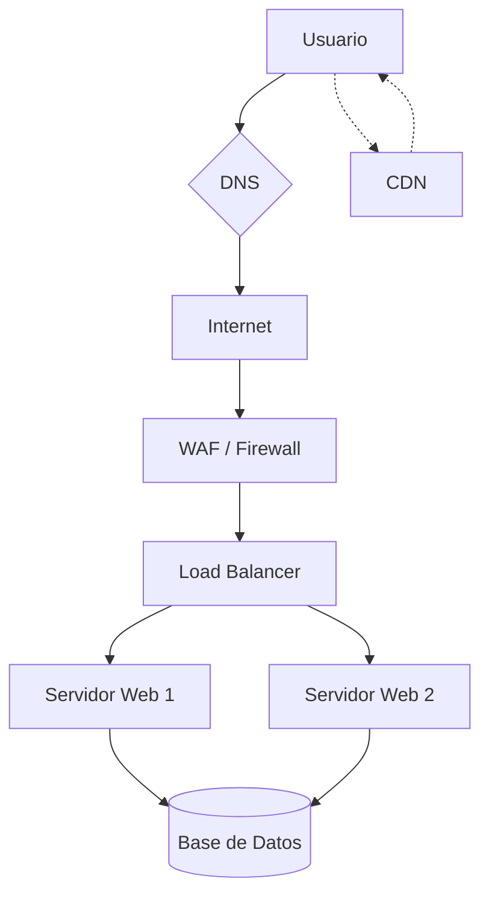

# 🏁 Poniéndolo Todo Junto (Putting It All Together)

**Fuente:** [TryHackMe - Putting It All Together](https://tryhackme.com/room/puttingitalltogether)
**Serie:** Web Fundamentals (Final)
**Tags:** #networking #web-infrastructure #load-balancers #cdn #waf

---

## 1. Infraestructura Web Avanzada
Más allá del servidor y el cliente, existen componentes intermedios que optimizan y protegen la comunicación.

| Componente | Función Principal |
| :--- | :--- |
| **Load Balancer** | Distribuye el tráfico entre varios servidores para evitar saturación y garantizar disponibilidad. |
| **WAF (Web Application Firewall)** | Filtra el tráfico HTTP para bloquear ataques conocidos (SQLi, XSS, etc.) antes de que lleguen al servidor. |
| **CDN (Content Delivery Network)** | Red de servidores distribuidos geográficamente que sirven contenido estático (imágenes, JS) desde el nodo más cercano al usuario. |

---

## 2. El Viaje de una Petición (The Request Journey)
Este es el proceso completo desde que escribes una URL hasta que ves la página:

1. **DNS Lookup:** El navegador pregunta al servidor DNS: "¿Cuál es la IP de `tryhackme.com`?".
2. **Conexión TCP/IP:** Se establece el "apretón de manos" (Three-way handshake) con la IP obtenida.
3. **Negociación TLS (HTTPS):** Si el sitio es seguro, se intercambian certificados para cifrar la conexión.
4. **Petición HTTP:** El navegador envía el método (`GET`), las cabeceras (`Host`, `User-Agent`) y las `Cookies`.
5. **Procesamiento en Servidor:**
    - El **Load Balancer** recibe la petición y la deriva a un servidor libre.
    - El **WAF** analiza si la petición es maliciosa.
    - El servidor web busca el archivo o ejecuta el código (PHP, Python, etc.).
6. **Respuesta HTTP:** El servidor responde con un código de estado (ej. `200 OK`) y el contenido (HTML/JSON).
7. **Renderizado:** El navegador interpreta el HTML, descarga recursos extra (vía CDN) y ejecuta el JavaScript.

---

## 3. Componentes de Seguridad y Rendimiento

> [!INFO] Load Balancers (Balanceadores de Carga)
> Utilizan algoritmos como **Round Robin** (uno a cada servidor) o **Least Connections** (al que tenga menos carga). Ayudan a prevenir caídas por exceso de tráfico.

> [!SHIELD] WAF vs Firewall de Red
> Mientras que un firewall tradicional bloquea puertos (ej. bloquea el puerto 22), el **WAF** inspecciona el *contenido* de los paquetes HTTP en el puerto 80/443 buscando patrones de ataque.

> [!TIP] CDN y Caché
> Una CDN no solo reduce la latencia, sino que también ahorra ancho de banda al servidor principal (*Origin Server*) al almacenar copias de archivos pesados en el "borde" (Edge servers).

---

## 4. Resumen de la Arquitectura Web Completa

## 📝 Conclusiones para Pentesting

Identificación: Saber si hay un WAF o un Load Balancer cambia la estrategia de escaneo (pueden banear tu IP rápido).

Headers: Analizar cabeceras como X-Forwarded-For puede revelar IPs reales detrás de un balanceador.

Superficie de Ataque: Cada componente intermedio es un punto potencial de fallo o de configuración incorrecta.